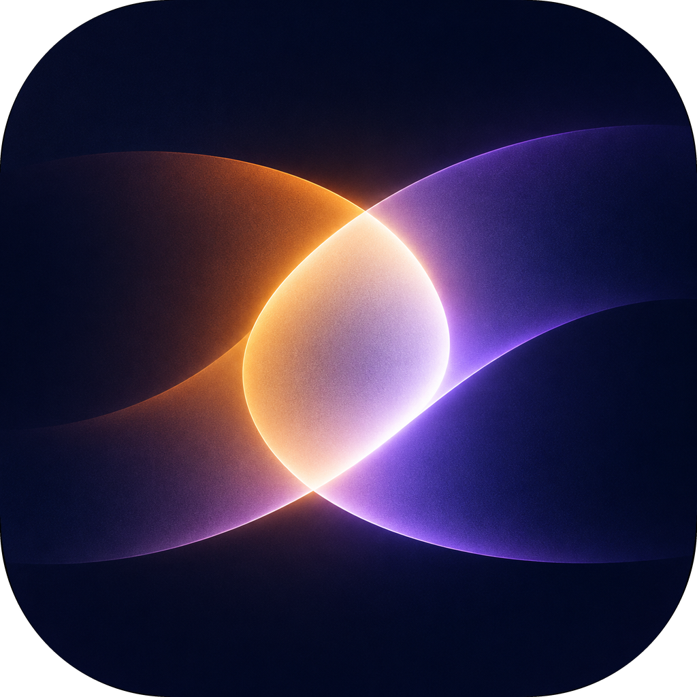

<p align="center">
  
</p>

<h1 align="center">LumiReel</h1>

<p align="center">
  Make videos with a coding agent — every frame is code.
</p>

<p align="center">
  <a href="LICENSE"></a>
  
  
</p>

<p align="center">
  <b>English</b> · <a href="README.zh-CN.md">简体中文</a>
</p>

---

LumiReel is a native desktop app for producing videos together with an AI coding agent. A video is
a small, deterministic HTML program; you describe what you want, the agent writes it, and LumiReel
previews and renders it.

## Features

- **Agent-native workflow** — the agent works in a real PTY inside the project folder, with the `reel`
  CLI on its `PATH` and project instructions (`AGENTS.md` / `CLAUDE.md`) installed for it.
- **Point at what you mean** — select a time range or drag a box over the preview, and a precise
  reference is pasted into the agent's prompt.
- **Session history** — the agent's own past sessions are read from Claude Code, Pi, Codex and
  OpenCode, so a restart or an app quit does not lose the conversation; resume one from the history
  button in the agent panel.
- **Deterministic by design** — a video is a pure function of time, so any frame can be inspected,
  checked and re-rendered exactly.
- **Live preview** — edits on disk are picked up automatically.
- **One-command export** — `reel render` writes an MP4 via `ffmpeg`, including the audio mix.

## How a video works

Each project is a folder containing one HTML page with a single `<canvas>` and a
`window.reel.paint(t)` function:

```js
window.reel.paint = (t) => {
  // Draw the frame at time t (seconds). The same t must always produce the same picture.
};
```

Because frames depend only on `t`, LumiReel can seek, sample and render without playing the video
in real time.

## Install

On macOS, via [Homebrew](https://brew.sh) (Homebrew 7 and later ask you to trust the tap first):

```bash
brew trust osdodo/lumireel
brew install --cask osdodo/lumireel/lumireel
```

Windows (`.exe` installer) and Linux (`.deb` / `.rpm`) builds are attached to each
[release](https://github.com/osdodo/lumireel/releases).

## Requirements

- At least one coding agent CLI installed, e.g. [Claude Code](https://docs.anthropic.com/en/docs/claude-code)
- [`ffmpeg`](https://ffmpeg.org) on `PATH` — required for rendering and some media processing

### Installing `ffmpeg`

| Platform | Command |
|---|---|
| macOS | `brew install ffmpeg` |
| Windows | `winget install Gyan.FFmpeg` (or `scoop install ffmpeg` / `choco install ffmpeg`) |
| Debian / Ubuntu | `sudo apt install ffmpeg` |
| Fedora | `sudo dnf install ffmpeg` |
| Arch Linux | `sudo pacman -S ffmpeg` |
| openSUSE | `sudo zypper install ffmpeg` |

Alternatively, download a static build from [ffmpeg.org/download.html](https://ffmpeg.org/download.html) and put
the binary on your `PATH`. Verify the install with `ffmpeg -version`.

## Usage

1. Launch LumiReel and click **New Project**. The project starts from a 3-second template.
2. In the agent terminal, describe the video you want.
3. Watch the preview update as the agent edits. Select a range or region to give it precise feedback.
4. Render the final video with `reel render`.

### The `reel` CLI

`reel` ships with the app and is available inside every agent terminal:

| Command | Description |
|---|---|
| `reel peek` | Contact sheet of the whole video, plus a determinism check |
| `reel peek 4.5` | A single frame at full size |
| `reel peek 3-6` | Twelve frames sampled from a time range |
| `reel render [--fps 30] [-o out.mp4]` | Render the project to MP4 (default `<project>.mp4`) |

## Configuration

| Setting | Default |
|---|---|
| Project library | `~/Movies/lumireel` on macOS (`~/Videos/lumireel` elsewhere) |
| Library override | `LUMIREEL_LIBRARY_DIR` environment variable |
| App settings | `~/Library/Application Support/lumireel/config.json` on macOS, `%APPDATA%\lumireel\config.json` on Windows, `~/.config/lumireel/config.json` on Linux |
| Interface language | Follows the system language, changeable in Settings (gear icon, top right) |
| Language override | `LUMIREEL_LOCALE=<code>`, one of `en`, `zh-CN`, `zh-TW`, `ja`, `ko`, `es`, `fr`, `de`, `pt-BR`, `ru` |

The agent command chosen in the UI is remembered between launches.

## License

Released under the [MIT License](LICENSE).
