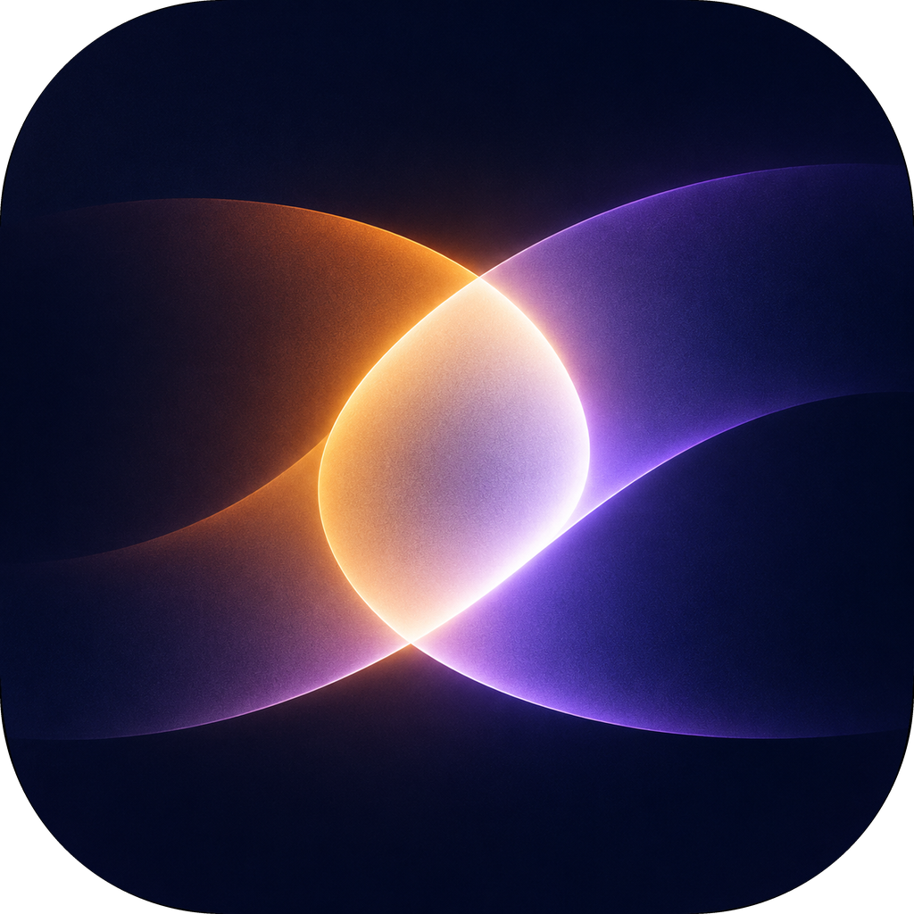

<p align="center">
  
</p>

<h1 align="center">LumiReel</h1>

<p align="center">
  与编码智能体一起做视频 —— 每一帧都是代码。
</p>

<p align="center">
  <a href="LICENSE"></a>
  
  
</p>

<p align="center">
  <a href="README.md">English</a> · <b>简体中文</b>
</p>

---

LumiReel 是一款原生桌面应用，让你和 AI 编码智能体协作制作视频。一个视频就是一段小而确定的 HTML
程序：你描述想要的效果，智能体把它写出来，LumiReel 负责预览和渲染。

## 特性

- **为智能体而生的流程** —— 智能体在项目文件夹内的真实 PTY 中工作，`reel` CLI 已加入它的
  `PATH`，并且为它准备好了项目说明（`AGENTS.md` / `CLAUDE.md`）。
- **指着说就行** —— 在预览上框选一段时间或拖出一个区域，一条精确的引用就会被粘贴进智能体的提示词里。
- **会话历史** —— 应用会从 Claude Code、Pi、Codex 和 OpenCode 自身的存储中读取历史会话，所以重启应用或
  关闭应用都不会丢失对话；在智能体面板的历史记录按钮中即可恢复。
- **确定性的设计** —— 视频是时间的纯函数，因此任意一帧都可以被检查、校验并精确地重新渲染。
- **实时预览** —— 磁盘上的改动会被自动拾取。
- **一条命令导出** —— `reel render` 通过 `ffmpeg` 输出 MP4，包含混音后的音频。

## 视频是如何工作的

每个项目都是一个文件夹，里面包含一个 HTML 页面，该页面只有一个 `<canvas>` 和一个
`window.reel.paint(t)` 函数：

```js
window.reel.paint = (t) => {
  // 绘制时间 t（秒）处的帧。相同的 t 必须始终产生相同的画面。
};
```

因为帧只依赖 `t`，LumiReel 无需实时播放即可跳转、采样和渲染。

## 安装

macOS 上可通过 [Homebrew](https://brew.sh) 安装：

```bash
brew install --cask osdodo/lumireel/lumireel
```

Windows（`.exe` 安装包）和 Linux（`.deb` / `.rpm`）的构建产物附在每个
[Release](https://github.com/osdodo/lumireel/releases) 中。

## 环境要求

- 至少安装一个编码智能体 CLI，例如 [Claude Code](https://docs.anthropic.com/en/docs/claude-code)
- `PATH` 中有 [`ffmpeg`](https://ffmpeg.org) —— 渲染和部分媒体处理需要它

### 安装 `ffmpeg`

| 平台 | 命令 |
|---|---|
| macOS | `brew install ffmpeg` |
| Windows | `winget install Gyan.FFmpeg`（或 `scoop install ffmpeg` / `choco install ffmpeg`） |
| Debian / Ubuntu | `sudo apt install ffmpeg` |
| Fedora | `sudo dnf install ffmpeg` |
| Arch Linux | `sudo pacman -S ffmpeg` |
| openSUSE | `sudo zypper install ffmpeg` |

也可以从 [ffmpeg.org/download.html](https://ffmpeg.org/download.html) 下载静态构建包，把可执行文件放进
`PATH`。用 `ffmpeg -version` 验证安装是否成功。

## 使用

1. 启动 LumiReel 并点击 **新建项目**。项目会从一个 3 秒的模板开始。
2. 在智能体终端里描述你想要的视频。
3. 智能体编辑时，观察预览的更新。选中一段时间或一块区域，给它精确的反馈。
4. 用 `reel render` 渲染最终视频。

### `reel` CLI

`reel` 随应用一起分发，在每个智能体终端中都可以使用：

| 命令 | 说明 |
|---|---|
| `reel peek` | 整个视频的拼贴预览图，并附带确定性检查 |
| `reel peek 4.5` | 以完整尺寸查看单个帧 |
| `reel peek 3-6` | 从一段时间区间内采样十二帧 |
| `reel render [--fps 30] [-o out.mp4]` | 将项目渲染为 MP4（默认输出 `<project>.mp4`） |

## 配置

| 设置项 | 默认值 |
|---|---|
| 项目库 | macOS 上为 `~/Movies/lumireel`（其他平台为 `~/Videos/lumireel`） |
| 项目库覆盖 | 环境变量 `LUMIREEL_LIBRARY_DIR` |
| 应用设置 | macOS 为 `~/Library/Application Support/lumireel/config.json`，Windows 为 `%APPDATA%\lumireel\config.json`，Linux 为 `~/.config/lumireel/config.json` |
| 界面语言 | 跟随系统语言，可在设置（右上角齿轮）中修改 |
| 语言覆盖 | `LUMIREEL_LOCALE=<代码>`，可选 `en`, `zh-CN`, `zh-TW`, `ja`, `ko`, `es`, `fr`, `de`, `pt-BR`, `ru` |

在界面中选择的智能体命令会在多次启动之间被记住。

## 许可证

基于 [MIT 许可证](LICENSE) 发布。
